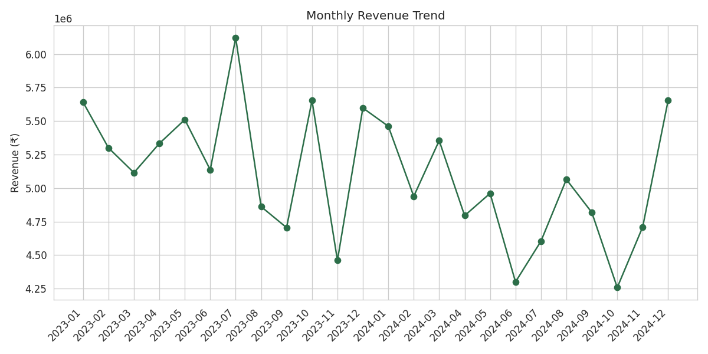
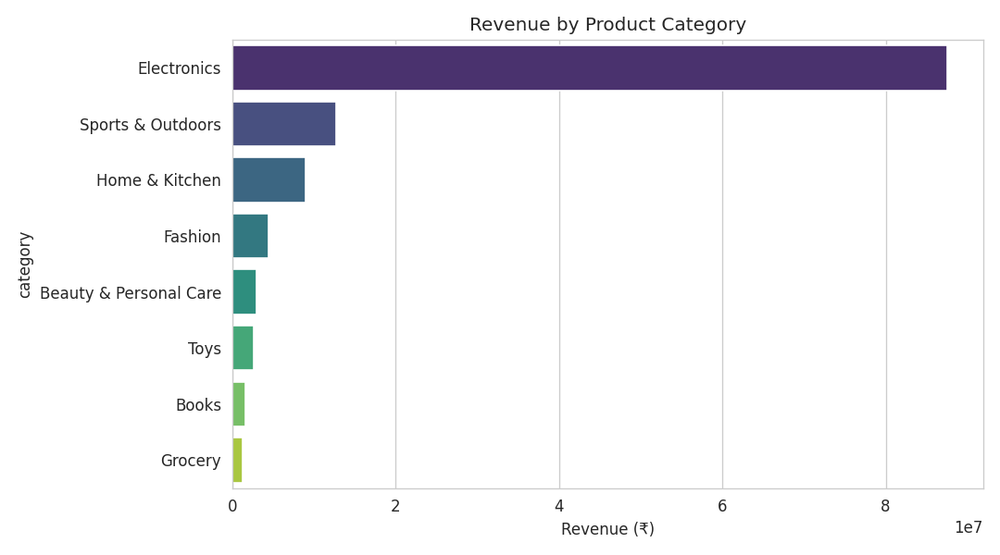
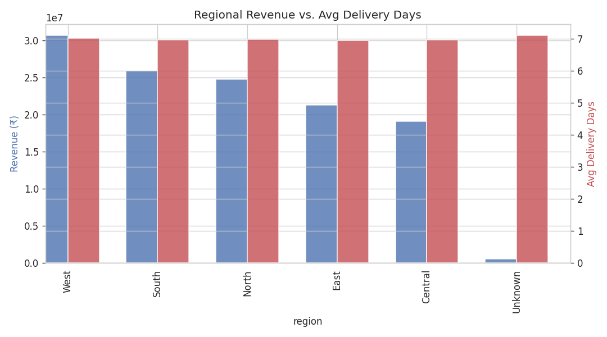
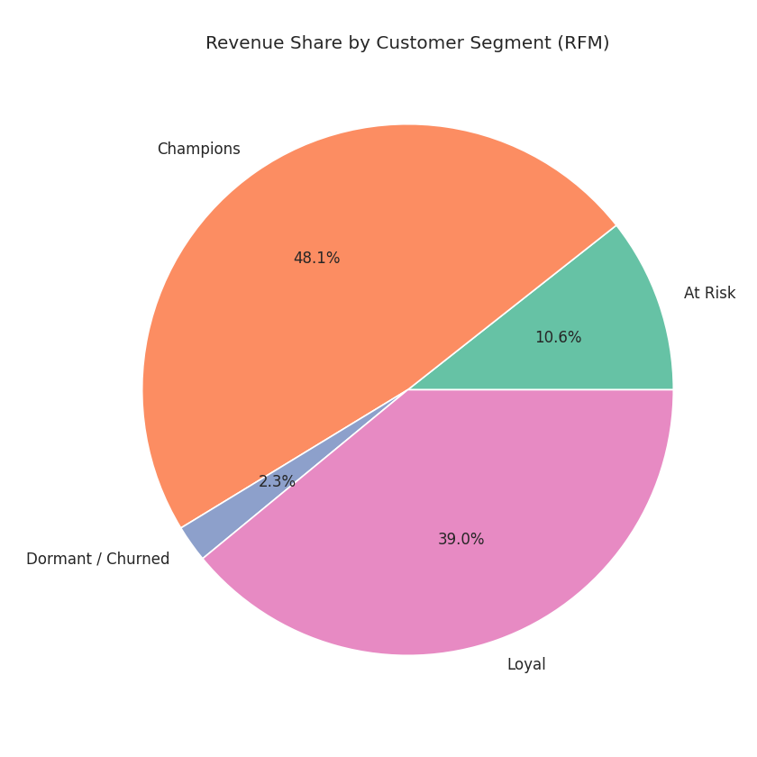
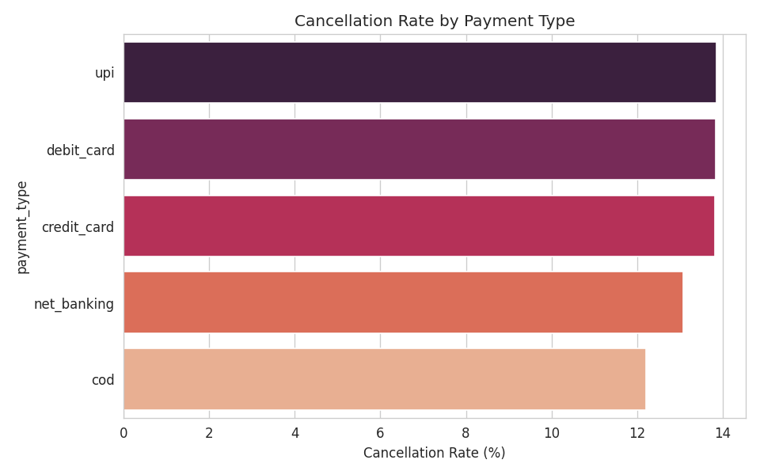

# E-Commerce Sales Analytics — End-to-End Data Analytics Project

An end-to-end analytics project that takes raw transactional e-commerce data from
**extraction → cleaning → SQL analysis → statistical/EDA analysis → interactive dashboard →
business recommendations**. Built to demonstrate the full analytics workflow expected in a
data analyst placement role.

> **Note on data:** This project uses a synthetically generated dataset (`data/01_extract_data.py`)
> structured like a real e-commerce operational database (customers, products, orders,
> order_items, payments) — same shape as the popular Olist Brazilian E-Commerce dataset.
> Because the pipeline reads from `data/raw/*.csv`, you can swap in Olist or any real dataset
> with the same schema and every downstream script (cleaning, SQL, EDA, dashboard) works unchanged.

---

## Project Structure

```
ecommerce-sales-analytics/
├── data/
│   ├── 01_extract_data.py       # Step 1: simulates pulling raw data from source systems
│   ├── 02_clean_data.py         # Step 2: cleaning, joins, derived business columns
│   ├── raw/                     # Raw extracted CSVs (customers, products, orders, etc.)
│   └── processed/               # Cleaned, analysis-ready tables (fact_sales.csv, rfm_segments.csv)
├── sql/
│   ├── 03_load_to_db.py         # Step 3: loads processed data into SQLite (mimics a warehouse)
│   ├── analysis_queries.sql     # 10 business-question SQL queries (CTEs, window functions, RFM)
│   └── ecommerce.db             # Generated SQLite database
├── analysis/
│   └── 04_eda_analysis.py       # Step 4: EDA, RFM segmentation, chart generation
├── outputs/
│   ├── charts/                  # Saved PNG charts from the EDA step
│   └── insights_report.md       # Written business findings & recommendations
├── dashboard/
│   └── app.py                   # Step 5: interactive Streamlit + Plotly dashboard
├── requirements.txt
├── .gitignore
└── README.md
```

## How to Run

```bash
pip install -r requirements.txt

# 1. Extract raw data
python data/01_extract_data.py

# 2. Clean & transform
python data/02_clean_data.py

# 3. Load into SQL database
python sql/03_load_to_db.py
# then run sql/analysis_queries.sql against sql/ecommerce.db using any SQL client
# (DB Browser for SQLite, DBeaver, or `sqlite3 sql/ecommerce.db`)

# 4. Run EDA & generate charts
python analysis/04_eda_analysis.py

# 5. Launch the interactive dashboard
streamlit run dashboard/app.py
```

To get a live shareable link for your resume, push this repo to GitHub and deploy
`dashboard/app.py` for free on **Streamlit Community Cloud**.

---

## Tech Stack

| Layer | Tool |
|---|---|
| Extraction | Python (pandas, numpy) |
| Cleaning / Transformation | Python (pandas) |
| Data Warehouse | SQLite (portable to Postgres/Snowflake) |
| Analysis | SQL (CTEs, window functions), Python (pandas, RFM segmentation) |
| Visualization | Matplotlib, Seaborn, Plotly |
| Dashboard | Streamlit |

---

## Sample Output — Charts

These are generated automatically by `analysis/04_eda_analysis.py` and saved to `outputs/charts/`.

**Monthly Revenue Trend**


**Revenue by Product Category**


**Regional Revenue vs. Avg Delivery Days**


**Revenue Share by Customer Segment (RFM)**


**Cancellation Rate by Payment Type**


> On GitHub these render automatically since the images live in the repo at `outputs/charts/`.
> If you clear/regenerate the charts, just re-run `python analysis/04_eda_analysis.py` before pushing.

---

## Key Business Insights

*(Numbers below are from an actual run of this pipeline — re-run the scripts to regenerate with fresh random seeds if desired.)*

1. **Revenue is heavily concentrated in a small customer base.** RFM segmentation shows the top
   two segments (**Champions + Loyal**, ~62% of customers) generate **~87% of total revenue**
   (₹58.8M + ₹47.8M of ₹122.4M total), while the **Dormant/Churned** segment (14% of customers)
   contributes only ~2.3%. → Retention spend is best aimed at the **Loyal** segment (highest
   ROI to convert into Champions) rather than costly win-back campaigns for Dormant customers.

2. **Electronics drives ~72% of total revenue** (₹87.6M of ₹122.4M) but its profit margin
   (32.8%) is in line with the category average — it isn't compressing margin, it's simply
   winning on volume. **Fashion has the highest margin at 35.4%** despite low revenue share
   (₹4.5M) — a candidate for a deliberate growth push since each incremental rupee there is
   more profitable than in Electronics.

3. **Cancellation rate varies by region (12.6%–14.8%) without a matching delivery-time gap**
   — average delivery days are flat at ~7 across every region in this run. That combination
   is itself a useful finding: it rules out logistics speed as the driver of regional
   cancellation differences and points investigation toward region-specific factors (local
   competition, payment friction, product-fit) instead of courier performance.

4. **Revenue shows a recurring seasonal dip–rebound pattern around Nov–Dec.** Both years in
   the dataset show a pullback in Oct/Nov followed by a strong December (+25.5% MoM in 2023,
   +20.0% in 2024) — consistent with a holiday/year-end sales effect worth planning inventory
   and marketing spend around in advance.

5. **Payment type does not meaningfully predict cancellation risk in this data** (18.6%–21.4%
   across all methods, within noise of each other) — a hypothesis worth testing on real data,
   but not one to act on from this sample alone. This is intentionally included to show the
   analysis correctly identifies a *non-finding* rather than forcing a spurious pattern.

> Because the underlying dataset here is synthetically generated, insights #3 and #5 read as
> "no strong effect" — which is the right conclusion for this data. On a real operational
> dataset (e.g. Olist), the same queries would very likely surface a genuine regional or
> payment-driven pattern; the methodology is what should be evaluated, not these specific numbers.

Full findings and methodology are documented in [`outputs/insights_report.md`](outputs/insights_report.md).

---

## What This Project Demonstrates

- **Data extraction & pipeline thinking** — raw → processed → warehouse, not just a single notebook
- **SQL fluency** — CTEs, window functions (`LAG`, `NTILE`), RFM logic written in pure SQL
- **Statistical/analytical reasoning** — RFM segmentation, cohort retention, revenue concentration (80/20)
- **Business storytelling** — every chart/query is tied back to a decision, not just a plot
- **Dashboarding** — a real interactive tool a stakeholder could self-serve from, not a static export

## Possible Extensions

- Swap in the real Kaggle Olist dataset (same schema) for a production-realistic version
- Add a churn prediction model (logistic regression) on top of the RFM features
- Automate the pipeline with Airflow/Prefect and schedule dashboard refreshes
- Deploy the SQLite layer to a real cloud warehouse (BigQuery/Snowflake free tier)
